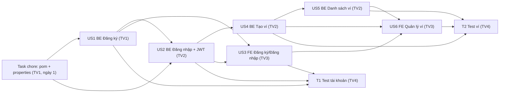

# SPRINT 1 — TÀI KHOẢN VÀ VÍ CƠ BẢN

> **Dự án:** Hệ thống Quản lý Chi tiêu Cá nhân  
> **Jira Project Key:** `QNK` (theo quy ước Git trong [CODING_CONVENTIONS.md](../CODING_CONVENTIONS.md))  
> **Thời lượng:** 2 tuần (10 ngày làm việc)  
> **Nhóm:** 4 thành viên — 1 Scrum Master kiêm Developer, 2 Developer, 1 Tester  
> **Tiêu chuẩn áp dụng:** [CODING_CONVENTIONS.md](../CODING_CONVENTIONS.md), [quan_ly_chi_tieu.sql](../quan_ly_chi_tieu.sql)

---

## Mục lục

1. [Sprint Goal và phạm vi](#1-sprint-goal-và-phạm-vi)
2. [Phân tích hiện trạng mã nguồn trước Sprint](#2-phân-tích-hiện-trạng-mã-nguồn-trước-sprint)
3. [Phân công 4 thành viên](#3-phân-công-4-thành-viên)
4. [Product Backlog của Sprint 1 (User Stories)](#4-product-backlog-của-sprint-1-user-stories)
5. [Chi tiết từng User Story](#5-chi-tiết-từng-user-story)
6. [Đặc tả API dùng chung (API Contract)](#6-đặc-tả-api-dùng-chung-api-contract)
7. [Phân chia file/thư mục để tránh xung đột Git](#7-phân-chia-filethư-mục-để-tránh-xung-đột-git)
8. [Kế hoạch kiểm thử (Tester)](#8-kế-hoạch-kiểm-thử-tester)
9. [Lịch làm việc 10 ngày](#9-lịch-làm-việc-10-ngày)
10. [Definition of Ready / Definition of Done](#10-definition-of-ready--definition-of-done)
11. [Rủi ro và phụ thuộc](#11-rủi-ro-và-phụ-thuộc)
12. [Quy trình Git trong Sprint](#12-quy-trình-git-trong-sprint)
13. [Mẫu báo cáo Sprint 1](#13-mẫu-báo-cáo-sprint-1)
14. [Sprint Review và Retrospective](#14-sprint-review-và-retrospective)
15. [Checklist hành động ngay](#15-checklist-hành-động-ngay)

---

## 1. Sprint Goal và phạm vi

### 1.1. Sprint Goal

> **Hoàn thiện luồng đăng ký → đăng nhập → tạo ví → xem danh sách ví; đảm bảo các chức năng hoạt động với MySQL, có Unit Test, Test Case, Automation Test và có thể demo.**

### 1.2. Phạm vi

| Hạng mục | Trong Sprint 1 (IN) | Ngoài Sprint 1 (OUT — Sprint sau) |
| :--- | :--- | :--- |
| Epic 1 — Tài khoản | Đăng ký, đăng nhập (JWT) | Đổi mật khẩu, quên mật khẩu, cập nhật hồ sơ |
| Epic 2 — Ví | Tạo ví, xem danh sách ví của chính mình | Sửa ví, ngừng sử dụng ví, xem chi tiết ví, chuyển tiền giữa ví |
| Epic 3 — Danh mục | — | Toàn bộ |
| Epic 4 — Giao dịch | — | Toàn bộ |
| Epic 5 — Báo cáo | — | Toàn bộ |
| Epic 6 — Ngân sách | — | Toàn bộ |

- **Bảng CSDL sử dụng:** `users`, `wallets` (theo [quan_ly_chi_tieu.sql](../quan_ly_chi_tieu.sql)).
- **Công nghệ:** Spring Boot 3.5 (Java 21), Angular 21/TypeScript, MySQL 8.0.16+.
- Quy ước CSDL, Coding Conventions và Git **đã được thống nhất ở giai đoạn trước** → dùng làm tiêu chuẩn khi viết code, **không tạo thành User Story/Task thiết kế riêng** trong Sprint này.

### 1.3. Thước đo thành công của Sprint

1. Có ít nhất **một luồng nghiệp vụ chạy xuyên suốt** FE → BE → MySQL: đăng ký → đăng nhập → tạo ví → xem ví.
2. Code tuân thủ Coding Conventions (package, tên lớp, `ApiResponse<T>`, `/api/v1`, Conventional Commits).
3. Mỗi Story BE có Unit Test (JUnit 5 + Mockito + AssertJ); Story FE có component test.
4. Tester có Test Case, **Automation Test thật** cho một số chức năng và Test Report.
5. Jira phản ánh đúng tiến độ thật; đủ bằng chứng để điền báo cáo Sprint.

---

## 2. Phân tích hiện trạng mã nguồn trước Sprint

Đối chiếu mã nguồn hiện tại trong repo với Coding Conventions và file SQL, phát hiện các điểm **bắt buộc xử lý trong Sprint 1** (được đưa thành Sub-task của Story liên quan, không tách thành Story thiết kế riêng):

| # | Hiện trạng | Yêu cầu theo Conventions / SQL | Xử lý tại |
| :-- | :--- | :--- | :--- |
| 1 | Entity `User` có `username`, `password`, `firstname`, `lastname`, `dob`, cột `userid` | Bảng `users`: `user_id`, `full_name`, `email`, `password_hash`, `created_at`, `updated_at` | US1 (TV1) |
| 2 | Package `DTO` viết hoa | Package chữ thường: `dto.request`, `dto.response` | US1 (TV1) |
| 3 | `UserControllers` (số nhiều), mapping `/users`, trả trực tiếp Entity | `UserController`, tiền tố `/api/v1`, trả `ApiResponse<T>` + Response DTO | US1 (TV1) |
| 4 | Mật khẩu lưu dạng plain text | Băm mật khẩu (BCrypt) trước khi lưu | US1 (TV1) |
| 5 | Chưa có `ApiResponse<T>`, `GlobalExceptionHandler`, custom exception | Có theo mục 3.2 Conventions | US1 (TV1) — nền tảng dùng chung |
| 6 | `pom.xml` thiếu `spring-boot-starter-validation`, `spring-boot-starter-security`, thư viện JWT, H2 (test) | Cần cho validate, BCrypt, JWT, integration test | Task kỹ thuật ngày 1 (TV1) |
| 7 | Chưa có `SecurityConfig`, JWT filter | Xác thực bằng token, lấy `userId` từ token | US2 (TV2) |
| 8 | `DB_URL` mặc định trỏ `ExpenseTrackerDB`; `ddl-auto=update` | Database `quan_ly_chi_tieu`; schema do file SQL quản lý → nên dùng `ddl-auto=validate` | Task kỹ thuật ngày 1 (TV1) |
| 9 | Có các API CRUD user cũ (`GET /users`, `DELETE /users/{id}`…) không có xác thực | Không nằm trong phạm vi và gây lộ dữ liệu | Gỡ bỏ trong US1 (TV1) |
| 10 | Frontend Angular 21 mới có trang mẫu của CLI (`app.html`), chưa có `HttpClient`, routing nghiệp vụ, `environment` | Cấu trúc `core/`, `features/`, `shared/` theo mục 4 Coding Conventions (Angular) | US3 (TV3) |

> [!NOTE]
> **Công nghệ Frontend đã chốt: Angular 21 + TypeScript** (Standalone Components, Signals, Reactive Forms), kiểm thử bằng **Vitest + Angular TestBed** qua `ng test`. Coding Conventions mục 4 và 5 đã được cập nhật tương ứng.

> [!NOTE]
> Các dependency không dùng trong Sprint 1 (`mssql-jdbc`, `thymeleaf`, `poi`, `itext`, `google-api-client`) không cần gỡ trong Sprint này để tránh xung đột; có thể dọn dẹp ở Sprint sau.

---

## 3. Phân công 4 thành viên

> Thay `TV1…TV4` bằng **Họ tên / MSSV** thực tế. Vai trò được **giữ ổn định trong suốt Sprint**.

| Thành viên | Vai trò | Họ tên / MSSV | Story Code phụ trách (SP) | Nhiệm vụ Test chéo (SP Test) | Tổng điểm quy đổi |
| :--- | :--- | :--- | :--- | :--- | :-: |
| **TV1** | Scrum Master kiêm Dev BE | `……………` | US1 + nền tảng BE (3 SP) | Điều phối Jira, Review PR, Báo cáo | **3.0** |
| **TV2** | Dev BE kiêm Tester | `……………` | US2 (3 SP), US4 (3 SP) | T_FE1: Test UI Đăng ký & Đăng nhập (3 SP) | **7.5** |
| **TV3** | Dev FE kiêm Tester | `……………` | US3 (3 SP), US6 (3 SP) | T_BE2: Test API Tạo ví & Xem ví (5 SP) | **8.5** |
| **TV4** | Dev BE kiêm Tester chính | `……………` | US5 (2 SP) | T_BE1: Test API Auth (6 SP) + T_FE2: Test UI ví (3 SP) | **6.5** |

> [!NOTE]
> **Mô hình triển khai: Kiểm thử chéo (Cross-Testing).** TV1 tập trung điều phối và nền tảng; TV2, TV3, TV4 **vừa code (+ Unit Test) vừa kiểm thử chéo** cho nhau. Điều này vừa giúp chia đều tải công việc (TV2 không bị gánh 8 SP, TV4 được tham gia viết code BE), vừa đảm bảo nguyên tắc kiểm thử độc lập khách quan.

### 3.1. TV1 — Scrum Master kiêm Developer BE

**Trách nhiệm Scrum Master**
- Tạo Sprint 1 trên Jira, đưa Story vào Sprint, tổ chức Sprint Planning để chốt Story Point.
- Điều phối Daily Scrum (15 phút/ngày), cập nhật Burndown, theo dõi blocker và gỡ vướng.
- Duyệt Pull Request (review code) theo Coding Conventions; đảm bảo không ai merge thẳng vào `main`.
- Tổ chức Sprint Review (demo) và Retrospective; tổng hợp số liệu báo cáo Sprint.

**Trách nhiệm Developer BE**
- Task kỹ thuật ngày 1: cập nhật `pom.xml`, `application.properties`, `.env.example`.
- Xây dựng nền tảng dùng chung: `ApiResponse<T>`, `GlobalExceptionHandler`, các custom exception.
- Refactor `User` entity/repository theo bảng `users`; code **API đăng ký** (US1) + Unit Test.

### 3.2. TV2 — Developer BE kiêm Tester

**Trách nhiệm Developer BE (6 SP Dev)**
- Xây dựng `SecurityConfig`, `JwtTokenProvider`, `JwtAuthenticationFilter`, CORS cho FE Angular.
- **API đăng nhập** (US2), **API tạo ví** (US4) + Unit Test tương ứng.
- Đảm bảo **quyền sở hữu dữ liệu**: `userId` luôn lấy từ token, không bao giờ lấy từ body/query.

**Trách nhiệm Tester chéo (3 SP Test)**
- Đảm nhận task `T_FE1`: Kiểm thử chức năng & UX trên Giao diện Đăng ký & Đăng nhập (US3 do TV3 làm).
- Viết Test Case manual kiểm tra validation form, chặn truy cập khi chưa đăng nhập, bắt lỗi BE hiển thị lên UI, ghi Bug trên Jira.

### 3.3. TV3 — Developer FE kiêm Tester

**Trách nhiệm Developer FE (6 SP Dev)**
- (Ngày 1) Dọn trang mẫu CLI, tạo cấu trúc `core/`, `features/`, `shared/`, `environments/`; cấu hình `provideHttpClient`.
- Tầng dùng chung: models, `AuthService`, `authInterceptor` (gắn token, xử lý 401), `authGuard`.
- **Giao diện đăng ký/đăng nhập** (US3), **giao diện quản lý ví** (US6) + component test.
- Tích hợp API thật; dùng mock theo API Contract (mục 6) khi BE chưa sẵn sàng.

**Trách nhiệm Tester chéo (5 SP Test)**
- Đảm nhận task `T_BE2`: Kiểm thử API Tạo ví (US4 của TV2) và API Xem danh sách ví (US5 của TV4).
- Viết Test Case và Postman Collection kiểm thử nghiệp vụ tạo ví, validate số dư, xem danh sách ví và bảo mật dữ liệu.

### 3.4. TV4 — Developer BE kiêm Tester chính

**Trách nhiệm Developer BE (2 SP Dev)**
- **API lấy danh sách ví** (US5) + Unit Test `WalletServiceTest`.
- Phối hợp với TV2 trên Entity và Repository của module Ví.

**Trách nhiệm Tester chính (9 SP Test)**
- Lập Test Plan tổng thể toàn Sprint ngay từ ngày 1; chuẩn bị CSDL test `quan_ly_chi_tieu_test`.
- Đảm nhận task `T_BE1` (6 SP): Kiểm thử tự động API Đăng ký (US1 của TV1) & Đăng nhập (US2 của TV2).
- Đảm nhận task `T_FE2` (3 SP): Kiểm thử giao diện Quản lý ví (US6 của TV3).
- Điều phối hợp nhất Postman Collection, chạy tự động bằng Newman CLI, xuất báo cáo HTML và lập Test Report tổng kết.

---

## 4. Product Backlog của Sprint 1 (User Stories)

Trên Jira: `Project → Backlog → Create Sprint` → đặt tên **`QNK Sprint 1 — Tài khoản và Ví cơ bản`**, Sprint Goal như mục 1.1, thời lượng 2 tuần. Tạo các Story sau và kéo vào Sprint.

| Story | Summary trên Jira | Epic | Assignee | SP | Phụ thuộc |
| :-- | :--- | :--- | :--- | :-: | :--- |
| US1 | `[BE] Đăng ký tài khoản` | Epic 1 | TV1 | 3 | — |
| US2 | `[BE] Đăng nhập hệ thống` | Epic 1 | TV2 | 3 | US1 (entity `User`) |
| US3 | `[FE] Giao diện đăng ký và đăng nhập` | Epic 1 | TV3 | 3 | API Contract US1, US2 |
| US4 | `[BE] Tạo ví mới` | Epic 2 | TV2 | 3 | US2 (JWT) |
| US5 | `[BE] Xem danh sách ví` | Epic 2 | TV4 | 2 | US2 (JWT), US4 |
| US6 | `[FE] Giao diện quản lý ví` | Epic 2 | TV3 | 3 | US3 (auth FE), API Contract US4, US5 |
| | **Tổng SP Developer** | | | **17** | |
| T_FE1 | `[TEST] Giao diện đăng ký & đăng nhập (US3)` | Epic 1 | TV2 | 3 | US3 |
| T_BE2 | `[TEST] API Tạo ví & Xem ví (US4, US5)` | Epic 2 | TV3 | 5 | US4, US5 |
| T_BE1 | `[TEST] API Đăng ký & Đăng nhập (US1, US2)` | Epic 1 | TV4 | 6 | US1, US2 |
| T_FE2 | `[TEST] Giao diện Quản lý ví (US6)` | Epic 2 | TV4 | 3 | US6 |
| | **Tổng SP Test chéo** | | | **17** | |

- **Phân công cân đối:** TV1 (3 SP Dev), TV2 (6 SP Dev + 3 SP Test), TV3 (6 SP Dev + 5 SP Test), TV4 (2 SP Dev + 9 SP Test).
- Story Point là **ước lượng đề xuất**; nhóm Planning Poker để chốt trước khi Start Sprint.

---

## 5. Chi tiết từng User Story

> Mỗi Story trên Jira cần nhập: **Description**, **Acceptance Criteria**, **Story Point**, **Assignee**, **Sub-task**. Phần dưới đây có thể copy trực tiếp vào Jira.

### US1 — `[BE] Đăng ký tài khoản` (TV1 · 3 SP)

**Description**
> Là người dùng mới, tôi muốn đăng ký tài khoản để sử dụng hệ thống quản lý chi tiêu cá nhân.

**Acceptance Criteria**
1. `POST /api/v1/users/register` đăng ký thành công khi dữ liệu hợp lệ → HTTP `201`, trả `UserResponse` (không chứa mật khẩu).
2. Từ chối email đã tồn tại → HTTP `409`, message `"Email đã được sử dụng"`.
3. Từ chối email sai định dạng → HTTP `400`.
4. Từ chối khi bỏ trống `fullName`, `email`, `password` → HTTP `400`, message chỉ rõ trường lỗi.
5. Mật khẩu tối thiểu 8 ký tự, tối đa 72 ký tự (giới hạn BCrypt).
6. Email được `trim()` và chuyển chữ thường trước khi kiểm tra trùng và lưu.
7. Mật khẩu được **băm bằng BCrypt** trước khi lưu vào cột `password_hash`.
8. Mọi phản hồi (thành công và lỗi) theo chuẩn `ApiResponse<T>`.

**Sub-task**

| # | Sub-task | Người làm | Kết quả bàn giao |
| :-- | :--- | :--- | :--- |
| 1.0 | Cập nhật `pom.xml` (validation, security, jjwt, h2 test), `application.properties` (`quan_ly_chi_tieu`, `ddl-auto=validate`), `.env.example` | TV1 | PR `chore` merge **trong ngày 1** |
| 1.1 | Tạo `ApiResponse<T>`, `GlobalExceptionHandler`, `ResourceNotFoundException`, `DuplicateResourceException`, `UnauthorizedException` | TV1 | Package `dto.response`, `exception` |
| 1.2 | Refactor `User` entity + `UserRepository` theo bảng `users`; đổi package `DTO` → `dto`; đổi `UserControllers` → `UserController`; gỡ API CRUD cũ | TV1 | Entity khớp schema |
| 1.3 | Implement `UserCreationRequest` (validation), `UserResponse`, `UserService`/`UserServiceImpl.register()`, endpoint đăng ký | TV1 | API chạy được |
| 1.4 | Viết và chạy Unit Test `UserServiceTest` (+ `UserControllerTest` nếu kịp) | TV1 | Test xanh, coverage Service ≥ 80% |
| 1.5 | Tích hợp API với MySQL, kiểm tra dữ liệu thật trong bảng `users` | TV1 | Ảnh chụp bản ghi có `password_hash` dạng `$2a$…` |
| 1.6 | Tester kiểm thử chức năng đăng ký và ghi nhận kết quả | TV4 | TC01, TC02, TC03, TC11 |

**Unit Test tối thiểu (`UserServiceTest`)**

| Phương thức test | Mục đích |
| :--- | :--- |
| `register_withValidData_shouldReturnUserResponse()` | Đăng ký thành công, không trả mật khẩu |
| `register_withExistingEmail_shouldThrowDuplicateResourceException()` | Email trùng |
| `register_withValidData_shouldHashPasswordBeforeSave()` | `passwordEncoder.encode()` được gọi, giá trị lưu ≠ mật khẩu gốc |
| `register_withUppercaseEmail_shouldNormalizeToLowercase()` | Chuẩn hóa email |

`UserControllerTest` (MockMvc, khuyến khích): `register_withInvalidEmail_shouldReturn400()`, `register_withBlankFullName_shouldReturn400()`.

---

### US2 — `[BE] Đăng nhập hệ thống` (TV2 · 3 SP)

**Description**
> Là người dùng đã có tài khoản, tôi muốn đăng nhập bằng email và mật khẩu để truy cập dữ liệu chi tiêu của mình.

**Acceptance Criteria**
1. `POST /api/v1/auth/login` với email + mật khẩu đúng → HTTP `200`, trả `accessToken` (JWT), `tokenType = "Bearer"`, `expiresIn`, thông tin người dùng cơ bản.
2. Sai mật khẩu **hoặc** email không tồn tại → HTTP `401`, cùng một message `"Email hoặc mật khẩu không đúng"` (không tiết lộ email có tồn tại hay không).
3. Bỏ trống email/mật khẩu → HTTP `400`.
4. JWT chứa `userId` (subject) và thời hạn; secret đọc từ biến môi trường `JWT_SECRET`, không hard-code.
5. Các endpoint ngoài `/api/v1/users/register`, `/api/v1/auth/login`, `/api/health` **bắt buộc có token**, thiếu/sai token → HTTP `401` theo `ApiResponse`.
6. CORS cho phép origin của FE (`http://localhost:4200` — cổng mặc định `ng serve`).

**Sub-task**

| # | Sub-task | Người làm |
| :-- | :--- | :--- |
| 2.1 | Implement `SecurityConfig` (BCrypt bean, stateless, permit endpoint công khai, CORS) | TV2 |
| 2.2 | Implement `JwtTokenProvider` + `JwtAuthenticationFilter`; tiện ích `SecurityUtils.getCurrentUserId()` | TV2 |
| 2.3 | Implement `LoginRequest`, `LoginResponse`, `AuthService`/`AuthServiceImpl.login()`, `AuthController` | TV2 |
| 2.4 | Viết và chạy Unit Test `AuthServiceTest`, `JwtTokenProviderTest` | TV2 |
| 2.5 | Tích hợp với CSDL (đăng nhập bằng tài khoản tạo từ US1) | TV2 |
| 2.6 | Tester kiểm thử chức năng đăng nhập | TV4 |

**Unit Test tối thiểu**

| Phương thức test | Mục đích |
| :--- | :--- |
| `login_withValidCredentials_shouldReturnToken()` | Đăng nhập thành công |
| `login_withWrongPassword_shouldThrowUnauthorizedException()` | Sai mật khẩu |
| `login_withNonExistingEmail_shouldThrowUnauthorizedException()` | Email không tồn tại |
| `generateToken_thenGetUserIdFromToken_shouldReturnSameUserId()` | JWT mã hóa/giải mã đúng |

---

### US3 — `[FE] Giao diện đăng ký và đăng nhập` (TV3 · 3 SP)

**Description**
> Là người dùng, tôi muốn có màn hình đăng ký và đăng nhập dễ dùng để tạo tài khoản và truy cập hệ thống.

**Acceptance Criteria**
1. Trang `/register`: form Họ tên, Email, Mật khẩu, Xác nhận mật khẩu; validate phía client (bắt buộc, định dạng email, mật khẩu ≥ 8 ký tự, xác nhận khớp).
2. Đăng ký thành công → thông báo và chuyển sang `/login`.
3. Trang `/login`: form Email, Mật khẩu; đăng nhập thành công → lưu token, chuyển sang `/wallets`.
4. Hiển thị đúng `message` lỗi từ BE (email trùng, sai mật khẩu…).
5. Nút submit bị vô hiệu hóa khi đang gửi request (tránh gửi trùng).
6. `authGuard`: chưa đăng nhập mà vào `/wallets` → chuyển về `/login`. Có nút **Đăng xuất** (xóa token).
7. Khi BE trả `401` với token hết hạn → `authInterceptor` tự xóa token và về `/login`.

**Sub-task**

| # | Sub-task | Người làm |
| :-- | :--- | :--- |
| 3.0 | Dọn trang mẫu CLI trong `app.html`; tạo cấu trúc `core/`, `features/`, `shared/`; tạo `environments/environment.ts` (`apiUrl`); thêm `provideHttpClient(withInterceptors([authInterceptor]))` vào `app.config.ts` | TV3 |
| 3.1 | Tạo `core/models` (`user.model.ts`, `api-response.model.ts`), `core/services/auth.service.ts` (register, login, logout, lưu token, signal `currentUser`), `core/interceptors/auth.interceptor.ts` | TV3 |
| 3.2 | Implement component `features/auth/register` và `features/auth/login` (Reactive Forms, `Validators`) | TV3 |
| 3.3 | Implement `core/guards/auth.guard.ts`, khai báo route trong `app.routes.ts` (lazy `loadComponent`) | TV3 |
| 3.4 | Viết test `register.spec.ts`, `login.spec.ts`, `auth.service.spec.ts` (HttpTestingController) | TV3 |
| 3.5 | Tích hợp API thật US1, US2 | TV3 |
| 3.6 | Tester kiểm thử luồng UI đăng ký → đăng nhập | TV4 |

**Test tối thiểu (Vitest + TestBed)**
- `Register`: hiển thị lỗi khi để trống; lỗi khi xác nhận mật khẩu không khớp; gọi `AuthService.register` với dữ liệu đúng (mock service bằng `vi.fn()`).
- `Login`: hiển thị lỗi khi service trả lỗi 401; gọi `AuthService.login` khi submit hợp lệ.
- `AuthService`: gửi đúng `POST /auth/login`, lưu `accessToken` vào `localStorage` khi thành công.

---

### US4 — `[BE] Tạo ví mới` (TV2 · 3 SP)

**Description**
> Là người dùng đã đăng nhập, tôi muốn tạo ví mới (tiền mặt, ngân hàng, tiết kiệm…) với số dư ban đầu để quản lý tiền theo từng nguồn.

**Acceptance Criteria**
1. `POST /api/v1/wallets` (cần token) với dữ liệu hợp lệ → HTTP `201`, trả `WalletResponse`; bản ghi được lưu vào bảng `wallets`.
2. `walletName` bắt buộc, không chỉ chứa khoảng trắng, tối đa 100 ký tự → vi phạm trả `400` (`"Tên ví không được để trống"`).
3. `initialBalance` không bắt buộc (mặc định `0.00`), phải `≥ 0`, tối đa 2 chữ số thập phân, phù hợp `DECIMAL(15,2)`.
4. Ví mới có `isActive = true`.
5. `userId` của ví **lấy từ token**; nếu body gửi kèm `userId` cũng bị bỏ qua.
6. Không có token → `401`.

**Sub-task**

| # | Sub-task | Người làm |
| :-- | :--- | :--- |
| 4.1 | Implement `Wallet` entity (`@ManyToOne User` hoặc `userId`), `WalletRepository` | TV2 |
| 4.2 | Implement `WalletCreateRequest`, `WalletResponse`, `WalletService`/`WalletServiceImpl.createWallet()`, `WalletController` | TV2 |
| 4.3 | Viết và chạy Unit Test `WalletServiceTest` (phần tạo ví) | TV2 |
| 4.4 | Tích hợp với CSDL, kiểm tra ràng buộc `chk_wallets_balance` | TV2 |
| 4.5 | Tester kiểm thử chức năng tạo ví | TV4 |

**Unit Test tối thiểu**

| Phương thức test | Mục đích |
| :--- | :--- |
| `createWallet_withValidData_shouldReturnCreatedWallet()` | Tạo thành công |
| `createWallet_withoutInitialBalance_shouldDefaultToZero()` | Biên số dư = 0 |
| `createWallet_withValidData_shouldAssignCurrentUserId()` | Gán đúng chủ sở hữu |
| `createWallet_whenUserNotExists_shouldThrowResourceNotFoundException()` | Token hợp lệ nhưng user đã bị xóa |

`WalletControllerTest` (khuyến khích): `createWallet_withBlankName_shouldReturn400()`, `createWallet_withNegativeBalance_shouldReturn400()`.

---

### US5 — `[BE] Xem danh sách ví` (TV4 · 2 SP)

**Description**
> Là người dùng đã đăng nhập, tôi muốn xem danh sách các ví của mình để biết số dư của từng ví.

**Acceptance Criteria**
1. `GET /api/v1/wallets` (cần token) → HTTP `200`, trả danh sách `WalletResponse` **chỉ thuộc người dùng hiện tại**.
2. Sắp xếp theo `createdAt` giảm dần (ví mới nhất lên đầu).
3. Người dùng chưa có ví → `200` với `data: []` (không phải lỗi).
4. Người dùng A **không bao giờ** thấy ví của người dùng B.
5. Không có token → `401`.

**Sub-task**

| # | Sub-task | Người làm |
| :-- | :--- | :--- |
| 5.1 | Thêm `WalletRepository.findByUserIdOrderByCreatedAtDesc()` (hoặc tương đương) | TV4 |
| 5.2 | Implement `WalletServiceImpl.getWalletsByUser()` + endpoint `GET` | TV4 |
| 5.3 | Viết và chạy Unit Test (phần danh sách); khuyến khích `WalletRepositoryTest` (`@DataJpaTest`) | TV4 |
| 5.4 | Tester kiểm thử danh sách ví và quyền sở hữu (TV3 kiểm thử chéo trong `T_BE2`) | TV3 |

**Unit Test tối thiểu**

| Phương thức test | Mục đích |
| :--- | :--- |
| `getWalletsByUser_whenUserHasWallets_shouldReturnList()` | Có dữ liệu |
| `getWalletsByUser_whenNoWallet_shouldReturnEmptyList()` | Danh sách rỗng |
| `getWalletsByUser_shouldQueryOnlyCurrentUserId()` | `verify` repository được gọi với đúng `userId` |

---

### US6 — `[FE] Giao diện quản lý ví` (TV3 · 3 SP)

**Description**
> Là người dùng đã đăng nhập, tôi muốn có giao diện để xem các ví và tạo ví mới.

**Acceptance Criteria**
1. Trang `/wallets` hiển thị danh sách ví: tên ví, số dư định dạng tiền Việt (`1.000.000 ₫`), trạng thái.
2. Hiển thị **tổng số dư** các ví (tính phía FE).
3. Chưa có ví → hiển thị trạng thái rỗng: *"Bạn chưa có ví nào. Hãy tạo ví đầu tiên!"* kèm nút tạo ví.
4. Form/Modal tạo ví: Tên ví, Số dư ban đầu; validate (bắt buộc tên, số dư ≥ 0).
5. Tạo thành công → đóng form, danh sách cập nhật ngay không cần tải lại trang.
6. Hiển thị trạng thái đang tải (loading) và thông báo lỗi khi API lỗi.

**Sub-task**

| # | Sub-task | Người làm |
| :-- | :--- | :--- |
| 6.1 | Tạo `core/models/wallet.model.ts`, `core/services/wallet.service.ts`, `shared/pipes/currency-vnd.pipe.ts` | TV3 |
| 6.2 | Implement component `features/wallet/wallet-list` (signal `wallets`, `computed` tổng số dư, `@for … @empty`) và `features/wallet/wallet-create-form` (Reactive Form, `output()` báo tạo thành công) | TV3 |
| 6.3 | Viết test `wallet-list.spec.ts`, `wallet-create-form.spec.ts`, `wallet.service.spec.ts`, `currency-vnd.pipe.spec.ts` | TV3 |
| 6.4 | Tích hợp API thật US4, US5 | TV3 |
| 6.5 | Tester kiểm thử luồng UI tạo và xem ví | TV4 |

**Test tối thiểu (Vitest + TestBed)**
- `WalletList`: render đúng số ví từ dữ liệu mock; hiển thị trạng thái rỗng khi mảng rỗng (xem ví dụ mục 5.5 Coding Conventions).
- `WalletCreateForm`: báo lỗi khi tên trống; gọi `WalletService.createWallet` khi hợp lệ.
- `WalletService`: gửi đúng `GET /wallets`, `POST /wallets` và bóc `data` từ `ApiResponse`.
- `CurrencyVndPipe`: `transform(1000000)` → `"1.000.000 ₫"`.

---

## 6. Đặc tả API dùng chung (API Contract)

> **Chốt trong ngày 1** giữa TV1, TV2, TV3, TV4. Sau khi chốt, mọi thay đổi phải báo cả nhóm trên kênh chung. TV3 dùng contract này để mock khi BE chưa xong; TV4 dùng để viết Test Case/Automation.

**Base URL:** `http://localhost:8080/api/v1`  
**Header xác thực:** `Authorization: Bearer <accessToken>`  
**Định dạng phản hồi:** luôn là `ApiResponse<T>` `{ "code", "message", "data" }`.

### 6.1. `POST /users/register` — công khai

Request:
```json
{
  "fullName": "Nguyễn Văn A",
  "email": "vana@example.com",
  "password": "Password@123"
}
```
Response `201`:
```json
{
  "code": 201,
  "message": "Đăng ký thành công",
  "data": {
    "userId": 1,
    "fullName": "Nguyễn Văn A",
    "email": "vana@example.com",
    "createdAt": "2026-11-02T09:00:00"
  }
}
```
Lỗi: `400` (thiếu trường / sai định dạng), `409` (email đã được sử dụng).

### 6.2. `POST /auth/login` — công khai

Request:
```json
{ "email": "vana@example.com", "password": "Password@123" }
```
Response `200`:
```json
{
  "code": 200,
  "message": "Đăng nhập thành công",
  "data": {
    "accessToken": "eyJhbGciOiJIUzI1NiJ9...",
    "tokenType": "Bearer",
    "expiresIn": 86400,
    "user": { "userId": 1, "fullName": "Nguyễn Văn A", "email": "vana@example.com" }
  }
}
```
Lỗi: `400` (thiếu trường), `401` (`"Email hoặc mật khẩu không đúng"`).

### 6.3. `POST /wallets` — cần token

Request:
```json
{ "walletName": "Ví tiền mặt", "initialBalance": 500000.00 }
```
Response `201`:
```json
{
  "code": 201,
  "message": "Tạo ví thành công",
  "data": {
    "walletId": 10,
    "walletName": "Ví tiền mặt",
    "balance": 500000.00,
    "isActive": true,
    "createdAt": "2026-11-03T10:00:00"
  }
}
```
Lỗi: `400` (tên trống / quá 100 ký tự / số dư âm), `401` (thiếu hoặc sai token).

### 6.4. `GET /wallets` — cần token

Response `200`:
```json
{
  "code": 200,
  "message": "Success",
  "data": [
    { "walletId": 11, "walletName": "Ví ngân hàng", "balance": 2000000.00, "isActive": true, "createdAt": "2026-11-03T11:00:00" },
    { "walletId": 10, "walletName": "Ví tiền mặt", "balance": 500000.00, "isActive": true, "createdAt": "2026-11-03T10:00:00" }
  ]
}
```
Chưa có ví: `"data": []`. Lỗi: `401`.

### 6.5. Bảng mã lỗi thống nhất

| HTTP | Trường hợp | Exception BE |
| :-: | :--- | :--- |
| 400 | Dữ liệu không hợp lệ | `MethodArgumentNotValidException` (được `GlobalExceptionHandler` chuyển thành `ApiResponse`) |
| 401 | Sai thông tin đăng nhập, thiếu/sai/hết hạn token | `UnauthorizedException` / Security entry point |
| 404 | Không tìm thấy tài nguyên | `ResourceNotFoundException` |
| 409 | Dữ liệu trùng (email) | `DuplicateResourceException` |
| 500 | Lỗi hệ thống (không lộ stack trace) | `Exception` |

---

## 7. Phân chia file/thư mục để tránh xung đột Git

### 7.1. Backend — `backend/src/main/java/com/expensemanagement/backend/`

| Package | File | Chủ sở hữu |
| :--- | :--- | :--- |
| *(gốc)* | `pom.xml`, `application.properties`, `.env.example` | **TV1** (merge ngày 1; sau đó ai sửa phải báo nhóm) |
| `dto.response` | `ApiResponse.java` | TV1 |
| `exception` | `GlobalExceptionHandler`, `ResourceNotFoundException`, `DuplicateResourceException`, `UnauthorizedException` | TV1 |
| `entity` | `User.java` | TV1 |
| `entity` | `Wallet.java` | TV2 |
| `repository` | `UserRepository.java` | TV1 (TV2 chỉ dùng `findByEmail`) |
| `repository` | `WalletRepository.java` | TV2 |
| `dto.request` | `UserCreationRequest.java` | TV1 |
| `dto.request` | `LoginRequest.java`, `WalletCreateRequest.java` | TV2 |
| `dto.response` | `UserResponse.java` | TV1 |
| `dto.response` | `LoginResponse.java`, `WalletResponse.java` | TV2 |
| `service` / `service.impl` | `UserService`, `UserServiceImpl` | TV1 |
| `service` / `service.impl` | `AuthService`, `AuthServiceImpl` | TV2 |
| `service` / `service.impl` | `WalletService`, `WalletServiceImpl` | TV2 (code `createWallet`), TV4 (code `getWalletsByUser`) |
| `controller` | `UserController.java` | TV1 |
| `controller` | `AuthController.java` | TV2 |
| `controller` | `WalletController.java` | TV2 (endpoint POST), TV4 (endpoint GET) |
| `config` | `SecurityConfig.java`, `JwtAuthenticationFilter.java` | TV2 |
| `util` | `JwtTokenProvider.java`, `SecurityUtils.java` | TV2 |

Test (`backend/src/test/java/com/expensemanagement/backend/`) phản chiếu đúng cấu trúc trên: `service/UserServiceTest` (TV1), `service/AuthServiceTest`, `service/WalletServiceTest`, `util/JwtTokenProviderTest` (TV2), `controller/*ControllerTest` (theo chủ sở hữu controller). Cấu hình test dùng H2: `src/test/resources/application-test.properties`.

### 7.2. Frontend — `frontend/src/` (toàn bộ do TV3 sở hữu, theo mục 4 Coding Conventions)

```
frontend/src
├── environments/
│   └── environment.ts               # apiUrl: 'http://localhost:8080/api/v1'
└── app/
    ├── core/
    │   ├── models/                  user.model.ts, wallet.model.ts, api-response.model.ts
    │   ├── services/                auth.service.ts, wallet.service.ts (+ .spec.ts)
    │   ├── interceptors/            auth.interceptor.ts (+ .spec.ts)
    │   └── guards/                  auth.guard.ts (+ .spec.ts)
    ├── features/
    │   ├── auth/
    │   │   ├── register/            register.ts, register.html, register.css, register.spec.ts
    │   │   └── login/               login.ts, login.html, login.css, login.spec.ts
    │   └── wallet/
    │       ├── wallet-list/         wallet-list.ts/.html/.css/.spec.ts   (trang /wallets)
    │       └── wallet-create-form/  wallet-create-form.ts/.html/.css/.spec.ts
    ├── shared/
    │   └── pipes/                   currency-vnd.pipe.ts (+ .spec.ts)
    ├── app.ts / app.html / app.css  # layout chung, nút Đăng xuất
    ├── app.config.ts                # provideRouter, provideHttpClient(withInterceptors([authInterceptor]))
    └── app.routes.ts                # /register, /login, /wallets (canActivate: [authGuard])
```

Lệnh tạo nhanh bằng Angular CLI:
```bash
ng generate component features/auth/login
ng generate component features/wallet/wallet-list
ng generate service core/services/wallet
ng generate guard core/guards/auth
ng generate interceptor core/interceptors/auth
ng generate pipe shared/pipes/currency-vnd
ng generate environments
```
> Nếu tên file CLI sinh ra khác quy ước (ví dụ `wallet.ts` thay vì `wallet.service.ts`, `auth-guard.ts` thay vì `auth.guard.ts`), đổi tên lại theo bảng 4.2 trong Coding Conventions trước khi commit.

### 7.3. Kiểm thử của Tester — `tests/` (TV4 sở hữu)

```
tests
├── api/
│   ├── sprint1.postman_collection.json
│   ├── local.postman_environment.json
│   └── README.md            # cách chạy: npx newman run ...
├── test-cases/
│   └── SPRINT_1_TEST_CASES.md   # hoặc file Excel đính kèm Jira
└── reports/
    └── SPRINT_1_TEST_REPORT.md  # + file HTML từ newman-reporter-htmlextra
```

---

## 8. Kế hoạch kiểm thử (Tester)

### 8.1. Phạm vi và chiến lược

| Cấp độ | Người thực hiện | Công cụ | Bằng chứng |
| :--- | :--- | :--- | :--- |
| Unit Test BE | TV1, TV2 | JUnit 5, Mockito, AssertJ | Kết quả `mvn test` + báo cáo coverage |
| Component Test FE | TV3 | Vitest + Angular TestBed (`ng test`) | Kết quả `npm run test` |
| API Automation Test | TV4 | Postman + Newman | Collection trong Git + báo cáo HTML |
| Manual Functional Test (UI) | TV4 | Trình duyệt | Test Case có Actual Result, ảnh chụp |
| Integration FE–BE–CSDL | TV4 | Trình duyệt + MySQL Workbench | Kiểm tra bản ghi trong `users`, `wallets` |
| Regression | TV4 | Chạy lại Newman + Test Case chính | Kết quả lần chạy cuối |

**Phân biệt rõ:**
- **Unit Test** — Developer kiểm tra logic từng đơn vị code (ví dụ `UserServiceTest`, `WalletServiceTest`), mock phụ thuộc.
- **Automation Test** — Tester tự động hóa hành vi chức năng qua API thật (gọi đăng nhập, tạo ví, kiểm tra kết quả).
- **Test Report** — tổng hợp số test đã chạy, Pass / Fail / Blocked, Bug phát hiện, kết quả retest.

> [!WARNING]
> **Không tính một Test Case thủ công là Automation Test** nếu chưa có script tự động thực hiện nó và đã chạy được. Chỉ ghi `M: x, A: y` sau khi thực sự đã tạo và chạy.

### 8.2. Danh sách Test Case

> Đây là **kế hoạch kiểm thử**, chưa phải kết quả. Khi chạy, Tester bổ sung các cột `Actual Result`, `Pass/Fail`, `Ngày chạy`, `Bug ID`, `Kết quả retest`.

**Nhóm T1 — Tài khoản (US1, US2, US3)**

| ID | Chức năng | Tiền điều kiện | Bước / Dữ liệu | Kết quả mong đợi | Loại |
| :-- | :--- | :--- | :--- | :--- | :--- |
| TC01 | Đăng ký | Email chưa tồn tại | Họ tên, email, mật khẩu hợp lệ | `201`; bản ghi mới trong `users`, `password_hash` đã băm | Manual + Automation |
| TC02 | Đăng ký | Email đã tồn tại | Đăng ký lại cùng email | `409`, "Email đã được sử dụng" | Manual + Automation |
| TC03 | Đăng ký | — | Email `abc@` | `400`, thông báo email sai định dạng | Manual |
| TC11 | Đăng ký | — | Bỏ trống họ tên / email / mật khẩu | `400`, chỉ rõ trường lỗi; UI hiển thị lỗi dưới từng ô | Manual |
| TC04 | Đăng nhập | Tài khoản đã đăng ký | Email + mật khẩu đúng | `200`, có `accessToken`; UI chuyển sang `/wallets` | Manual + Automation |
| TC05 | Đăng nhập | Tài khoản đã đăng ký | Mật khẩu sai | `401`, "Email hoặc mật khẩu không đúng" | Manual + Automation |
| TC12 | Đăng nhập | — | Email chưa đăng ký | `401`, cùng message như TC05 | Manual + Automation |
| TC13 | Luồng UI | — | Đăng ký → đăng nhập → đăng xuất → vào `/wallets` | Chuyển đúng trang; sau đăng xuất bị đưa về `/login` | Manual |

**Nhóm T2 — Ví (US4, US5, US6)**

| ID | Chức năng | Tiền điều kiện | Bước / Dữ liệu | Kết quả mong đợi | Loại |
| :-- | :--- | :--- | :--- | :--- | :--- |
| TC06 | Tạo ví | Đã đăng nhập | Tên "Ví tiền mặt", số dư 500000 | `201`; bản ghi trong `wallets` đúng `user_id` | Manual + Automation |
| TC07 | Tạo ví | Đã đăng nhập | Tên ví để trống / chỉ có khoảng trắng | `400`, "Tên ví không được để trống" | Manual |
| TC15 | Tạo ví | Đã đăng nhập | Số dư `-1000` | `400` | Manual |
| TC16 | Tạo ví | Đã đăng nhập | Tên ví 101 ký tự | `400` | Manual |
| TC08 | Danh sách ví | User đã có ≥ 2 ví | `GET /wallets` / mở trang `/wallets` | Hiển thị đúng số ví, tên, số dư, ví mới nhất đầu tiên | Manual + Automation |
| TC09 | Danh sách ví | User mới, chưa có ví | Mở trang `/wallets` | `data: []`; UI hiện trạng thái rỗng | Manual |
| TC10 | Bảo mật | User A có ví; User B đăng nhập | B gọi `GET /wallets`; B tạo ví kèm `userId` của A trong body | Danh sách của B không chứa ví của A; ví mới luôn thuộc B | Manual + Automation |
| TC14 | Bảo mật | — | Gọi `GET /wallets`, `POST /wallets` không có token / token sai | `401` | Manual + Automation |

> [!NOTE]
> Sprint 1 chưa có API `GET /wallets/{id}`, nên TC10 kiểm tra quyền sở hữu qua danh sách ví và qua việc bỏ qua `userId` trong body. Khi Sprint sau bổ sung API chi tiết/sửa ví, mở rộng TC10 để kiểm tra trả `403/404` khi truy cập ví của người khác.

### 8.3. Mục tiêu số lượng (chỉ là kế hoạch)

| Nhóm | Manual (M) | Automation (A) | Các TC tự động hóa |
| :--- | :-: | :-: | :--- |
| T1 — Tài khoản | 8 | 5 | TC01, TC02, TC04, TC05, TC12 |
| T2 — Ví | 8 | 4 | TC06, TC08, TC10, TC14 |
| **Tổng** | **16** | **9** | |

### 8.4. Hướng dẫn Automation Test (Postman + Newman)

1. Tạo environment `local` với `baseUrl = http://localhost:8080/api/v1`.
2. Request đăng ký dùng email động, ví dụ `test_{{$timestamp}}@example.com`, để test **chạy lặp lại được** (độc lập dữ liệu).
3. Request đăng nhập lưu token: `pm.environment.set("token", pm.response.json().data.accessToken)`.
4. Mỗi request có script kiểm tra: status code, `code`, `message`, cấu trúc `data` (ví dụ không có trường `password`/`passwordHash`).
5. TC10 dùng 2 tài khoản (`tokenA`, `tokenB`) tạo trong cùng collection.
6. Chạy bằng dòng lệnh và xuất báo cáo:
   ```bash
   npx newman run tests/api/sprint1.postman_collection.json -e tests/api/local.postman_environment.json -r cli,htmlextra --reporter-htmlextra-export tests/reports/newman-sprint1.html
   ```
7. Lưu collection và báo cáo vào Git (nhánh `test/QNK-xx-sprint1-api-automation`).

### 8.5. Quy trình Bug

- Tạo issue loại **Bug** trên Jira, liên kết (`is blocked by` / `relates to`) với Story liên quan.
- Nội dung bắt buộc: Bước tái hiện, Dữ liệu, Kết quả mong đợi, Kết quả thực tế, Ảnh/Log, Mức độ (`Critical / Major / Minor`).
- Developer sửa trên nhánh `bugfix/QNK-xx-…` → Tester **retest** → đóng Bug.
- Story còn Bug `Critical/Major` chưa đóng **không được tính Done**.

### 8.6. Mẫu Test Report cuối Sprint

| Chỉ số | Giá trị |
| :--- | :-: |
| Tổng số Test Case | … |
| Số TC đã chạy | … |
| Pass / Fail / Blocked | … / … / … |
| Số Automation Script đã chạy | … |
| Tỷ lệ Pass | …% |
| Số Bug phát hiện (Critical / Major / Minor) | … / … / … |
| Số Bug đã sửa và retest Pass | … |
| Bug còn tồn tại chuyển Sprint 2 | … |

---

## 9. Lịch làm việc 10 ngày

| Ngày | TV1 — SM + BE | TV2 — BE kiêm Tester | TV3 — FE kiêm Tester | TV4 — BE kiêm Tester chính |
| :-: | :--- | :--- | :--- | :--- |
| **1** | Sprint Planning, tạo Jira, chốt SP; merge PR `pom.xml`, DB | Phác thảo SecurityConfig, JWT; chốt API Contract | Dọn dẹp Angular, tạo cấu trúc `core/features/shared`, `environment` | Lập khung Test Plan Sprint 1; nghiên cứu logic `WalletRepository` |
| **2** | `ApiResponse`, `GlobalExceptionHandler`, refactor `User` | Implement `SecurityConfig`, JWT provider/filter, `AuthService` | Xây dựng `auth.service`, interceptor, guard, form đăng ký | Viết Test Case cho API Đăng ký & Đăng nhập (`T_BE1`) |
| **3** | API đăng ký + `UserServiceTest` → mở PR | API đăng nhập + `AuthServiceTest` → mở PR | Hoàn thành form đăng nhập, routing; viết test US3 | Kiểm thử API Đăng ký (US1) ngay khi có PR của TV1; ghi Bug |
| **4** | Review PR của TV2 & TV4; hỗ trợ tích hợp | `Wallet` entity, API tạo ví + Unit Test US4 → mở PR | Giao diện danh sách ví, form tạo ví (mock data) | Kiểm thử API Đăng nhập (US2); bắt đầu code US5 (`getWalletsByUser`) |
| **5** | Kiểm tra burndown, gỡ blocker; review PR | Chuẩn bị Test Case cho Giao diện ĐK/ĐN (`T_FE1`) | Hoàn thành màn hình danh sách ví, form tạo ví; viết test US6 | Hoàn thành US5 + `WalletServiceTest` → mở PR; viết Test Case UI ví |
| **6** | Hỗ trợ TV3 & TV4 tích hợp; review PR US5 | Bắt đầu test UI Đăng ký & Đăng nhập của TV3 (`T_FE1`) | Nối giao diện Đăng ký & Đăng nhập với API thật | Bắt đầu viết kịch bản Postman kiểm thử US4 & US5 |
| **7** | **Mid-sprint check**: Đánh giá tiến độ; kiểm tra dữ liệu MySQL | Tiếp tục test UI ĐK/ĐN, ghi Bug cho TV3 | Bắt đầu kiểm thử chéo API Tạo ví (US4) và Xem ví (US5) | Kiểm thử chéo UI Quản lý ví của TV3 (`T_FE2`); ghi Bug |
| **8** | Hỗ trợ nhóm gỡ vướng blocker kỹ thuật | Sửa lỗi Backend US2/US4 (nếu có); retest UI auth | Nối giao diện ví với API thật; sửa lỗi UI theo feedback TV2 | Hợp nhất Postman Collection, chạy tự động bằng Newman |
| **9** | Kiểm tra code coverage; chuẩn bị kịch bản demo | Hoàn thiện Unit Test US2, US4; chốt kết quả test `T_FE1` | Sửa lỗi UI ví theo feedback TV4; hoàn thiện test US6 | Retest toàn bộ Bug; xuất báo cáo Newman HTML; chốt Test Report |
| **10** | Sprint Review, cập nhật Jira, tổng hợp báo cáo | Demo chức năng Backend Đăng nhập & Tạo ví | Demo chức năng Frontend trên trình duyệt | Báo cáo kết quả kiểm thử, tỷ lệ Pass/Fail, thống kê Bug |

**Nghi thức Scrum trong Sprint**

| Sự kiện | Thời điểm | Thời lượng | Chủ trì |
| :--- | :--- | :-: | :--- |
| Sprint Planning | Ngày 1 | 1–2 giờ | TV1 |
| Daily Scrum (Hôm qua làm gì? Hôm nay làm gì? Vướng gì?) | Mỗi ngày | 15 phút | TV1 |
| Mid-sprint check | Ngày 7 | 30 phút | TV1 |
| Sprint Review (demo) | Ngày 10 | 45 phút | TV1 |
| Sprint Retrospective | Ngày 10 | 30 phút | TV1 |

> [!TIP]
> Không chờ đến ngày 8 mới kiểm thử. Tester viết Test Case từ ngày 1 và kiểm thử API/UI **ngay khi từng phần sẵn sàng**. Developer nên mở PR sớm (ngày 3–5) để có thời gian tích hợp.

---

## 10. Definition of Ready / Definition of Done

### 10.1. Definition of Ready (Story được phép đưa vào Sprint)
- [ ] Có Description dạng User Story và Acceptance Criteria rõ ràng.
- [ ] Đã ước lượng Story Point và có Assignee.
- [ ] API Contract liên quan đã được chốt (mục 6).
- [ ] Đã xác định phụ thuộc với Story khác.

### 10.2. Definition of Done (Story được tính hoàn thành 100%)
- [ ] Code đáp ứng **toàn bộ** Acceptance Criteria.
- [ ] Tuân thủ Coding Conventions (package, tên lớp/phương thức, `ApiResponse<T>`, `/api/v1`).
- [ ] Có Unit Test (BE) / component test (FE) theo mục 5, **tất cả đều Pass**; Service BE coverage ≥ 80%.
- [ ] Đã tích hợp với MySQL (BE) / API thật (FE).
- [ ] PR được ít nhất **1 thành viên khác review và approve**, merge vào nhánh `develop`.
- [ ] Tester đã chạy Test Case liên quan; không còn Bug `Critical/Major` mở.
- [ ] Jira chuyển trạng thái `Done`.

> [!IMPORTANT]
> Story chưa đạt 100% DoD **không được tính SP hoàn thành** trong báo cáo Sprint.

---

## 11. Rủi ro và phụ thuộc

| # | Rủi ro | Ảnh hưởng | Biện pháp |
| :-- | :--- | :--- | :--- |
| R1 | TV3 chưa quen Angular 21 (Signals, Standalone, control flow mới) | US3/US6 chậm | Bám mục 4 Coding Conventions, dùng `ng generate`; làm US3 trước để quen cấu trúc |
| R2 | TV2 quá tải (8 SP, phụ trách cả Security) | US5 trễ | Ưu tiên US2 → US4 → US5; dự phòng chuyển US5 sang TV1 ở Mid-sprint check |
| R3 | US4/US5 phụ thuộc JWT của US2 | TV2 bị nghẽn nếu US2 chậm | Làm `SecurityConfig` từ ngày 1; Unit Test Service không cần JWT (mock `userId`) |
| R4 | FE chờ BE | Tích hợp dồn cuối Sprint | FE mock theo API Contract; BE mở PR sớm |
| R5 | Xung đột Git ở `pom.xml`, `SecurityConfig` | Mất thời gian merge | Phân chia file mục 7; TV1 merge PR `chore` ngày 1 |
| R6 | Schema DB lệch giữa các máy | Lỗi khi chạy | Mọi người chạy cùng file [quan_ly_chi_tieu.sql](../quan_ly_chi_tieu.sql); `ddl-auto=validate` |
| R7 | TV1 kiêm nhiệm, thiếu thời gian điều phối | Jira không cập nhật, blocker không được gỡ | Cố định khung giờ điều phối; mỗi thành viên tự cập nhật Jira cuối ngày |
| R8 | Lộ secret (DB password, JWT secret) lên Git | Rủi ro bảo mật | Chỉ dùng `.env` (đã ignore); cập nhật `.env.example` với giá trị giả |

**Sơ đồ phụ thuộc**



---

## 12. Quy trình Git trong Sprint

### 12.1. Mô hình nhánh
- `main`: chỉ chứa code đã demo ổn định (merge cuối Sprint).
- `develop`: nhánh tích hợp trong Sprint (TV1 tạo ngày 1 từ `main`).
- Nhánh làm việc tách từ `develop`, đặt tên `{loại}/{mã-task-jira}-{mô-tả-ngắn}`.

### 12.2. Nhánh đề xuất (thay `QNK-xx` bằng mã Jira thật)

| Thành viên | Nhánh |
| :--- | :--- |
| TV1 | `chore/QNK-xx-sprint1-backend-setup`, `feature/QNK-xx-user-register-api` |
| TV2 | `feature/QNK-xx-auth-login-api`, `feature/QNK-xx-wallet-create-api`, `feature/QNK-xx-wallet-list-api` |
| TV3 | `chore/QNK-xx-frontend-setup`, `feature/QNK-xx-auth-ui`, `feature/QNK-xx-wallet-ui` |
| TV4 | `test/QNK-xx-sprint1-api-automation` |

### 12.3. Commit mẫu (Conventional Commits)
```
chore(build): thêm spring-boot-starter-validation, security và jjwt
refactor(user): chuẩn hóa entity User theo bảng users
feat(user): thêm API đăng ký tài khoản với mật khẩu băm BCrypt
test(user): bổ sung unit test cho UserService.register
feat(auth): thêm API đăng nhập và JWT filter
feat(wallet): thêm API tạo ví và lấy danh sách ví
test(wallet): bổ sung unit test cho WalletService
feat(auth-ui): thêm form đăng ký và đăng nhập
feat(wallet-ui): thêm trang danh sách ví và form tạo ví
test(api): thêm Postman collection kiểm thử Sprint 1
fix(wallet): từ chối số dư ban đầu âm
```

### 12.4. Quy tắc Pull Request
- Không push trực tiếp vào `main`/`develop`; mọi thay đổi qua PR.
- Tiêu đề PR chứa mã Jira, ví dụ `QNK-21 [BE] Đăng ký tài khoản`.
- PR phải chạy `mvn test` / `npm run test` Pass trước khi xin review.
- Reviewer mặc định: PR BE → người BE còn lại hoặc TV1; PR FE → TV1; PR test → TV1.

---

## 13. Mẫu báo cáo Sprint 1

> Theo mẫu *[Phát triển PMCN] Báo cáo Sprints*: ghi từng User Story của từng thành viên, SP, tiến độ, tổng SP hoàn thành, số Unit Test, số Test Case/Script, điểm quy đổi, xếp hạng đóng góp. **Story chưa đạt 100% không được tính SP.**

### 13.1. Bảng điền thật (cuối Sprint)

Theo mô hình kiểm thử chéo, mỗi thành viên có các dòng nhiệm vụ tương ứng:

| STT | Họ tên / MSSV | Vai trò | Nhiệm vụ thực hiện | Phân loại | SP | Tiến độ | Số Test thực tế | Điểm quy đổi |
| :-: | :--- | :--- | :--- | :---: | :-: | :-: | :---: | :-: |
| **1** | `……` | SM kiêm Dev BE | `[BE] Đăng ký tài khoản` (US1) | Dev | 3 | …% | … Unit Test | … |
| **2** | `……` | Dev BE kiêm Tester | `[BE] Đăng nhập hệ thống` (US2) | Dev | 3 | …% | … Unit Test | |
| | | | `[BE] Tạo ví mới` (US4) | Dev | 3 | …% | … Unit Test | |
| | | | `[TEST] Giao diện đăng ký & đăng nhập` (T_FE1) | Test | 3 | …% | M: …, A: … | … |
| **3** | `……` | Dev FE kiêm Tester | `[FE] Giao diện đăng ký và đăng nhập` (US3) | Dev | 3 | …% | … Spec Test | |
| | | | `[FE] Giao diện quản lý ví` (US6) | Dev | 3 | …% | … Spec Test | |
| | | | `[TEST] API Tạo ví & Xem ví` (T_BE2) | Test | 5 | …% | M: …, A: … | … |
| **4** | `……` | Dev BE kiêm Tester chính | `[BE] Xem danh sách ví` (US5) | Dev | 2 | …% | … Unit Test | |
| | | | `[TEST] API Đăng ký & Đăng nhập` (T_BE1) | Test | 6 | …% | M: …, A: … | |
| | | | `[TEST] Giao diện Quản lý ví` (T_FE2) | Test | 3 | …% | M: …, A: … | … |

### 13.2. Ví dụ minh họa (giả định mọi Story hoàn thành 100%)

> [!CAUTION]
> Các con số dưới đây **chỉ để minh họa cách tính theo mô hình kiểm thử chéo**. Khi kết thúc Sprint, phải thay bằng số liệu thực tế từ Jira, kết quả `mvn test`, `npm run test` và Newman.

| Thành viên | Vai trò | Story Dev hoàn thành | SP Dev | Story Test hoàn thành | SP Test | Tổng điểm quy đổi |
| :--- | :--- | :--- | :-: | :--- | :-: | :---: |
| **TV1** | SM kiêm Dev | US1 | 3 | — | — | **3.0** |
| **TV2** | Dev BE kiêm Tester | US2 (3) + US4 (3) | 6 | T_FE1 (3) | 3 | $6 + 3 \times 50\% =$ **7.5** |
| **TV3** | Dev FE kiêm Tester | US3 (3) + US6 (3) | 6 | T_BE2 (5) | 5 | $6 + 5 \times 50\% =$ **8.5** |
| **TV4** | Dev BE kiêm Tester chính | US5 (2) | 2 | T_BE1 (6) + T_FE2 (3) | 9 | $2 + 9 \times 50\% =$ **6.5** |
| **TỔNG** | | | **17** | | **17** | **25.5** |

**Cách tính:**
- Phần Code (Developer): điểm quy đổi = $100\% \times \text{tổng SP Dev hoàn thành 100\%}$.
- Phần Test (Tester): điểm quy đổi = $50\% \times \text{tổng SP Test hoàn thành 100\%}$.
- Tổng điểm cá nhân = Điểm Dev + Điểm Test.
- TV1 ghi rõ vai trò kiêm nhiệm; công việc Scrum Master thể hiện qua bằng chứng: Sprint/Story trên Jira, biên bản Daily/Review/Retro, PR đã review.

### 13.3. Bằng chứng cần thu thập trong Sprint

| Bằng chứng | Người thu thập |
| :--- | :--- |
| Ảnh Jira: Sprint board, Burndown chart, Story ở trạng thái Done | TV1 |
| Danh sách PR đã merge, commit theo Conventional Commits | TV1 |
| Kết quả `mvn test` (số test, Pass) + báo cáo coverage | TV1, TV2 |
| Kết quả `npm run test` | TV3 |
| Test Case có Actual Result, báo cáo HTML của Newman, danh sách Bug | TV4 |
| Ảnh dữ liệu trong bảng `users`, `wallets` sau khi demo | TV4 |
| Video/ảnh demo luồng đăng ký → đăng nhập → tạo ví → xem ví | TV1 + TV3 |

---

## 14. Sprint Review và Retrospective

### 14.1. Kịch bản demo Sprint Review (ngày 10)
1. Mở trang `/register` → đăng ký tài khoản mới → hiện thông báo thành công.
2. Mở MySQL → cho thấy bản ghi mới trong `users`, `password_hash` đã băm.
3. Đăng ký lại cùng email → hiển thị lỗi "Email đã được sử dụng".
4. Đăng nhập sai mật khẩu → báo lỗi; đăng nhập đúng → vào `/wallets`, thấy trạng thái rỗng.
5. Tạo 2 ví → danh sách và tổng số dư cập nhật ngay; kiểm tra bảng `wallets`.
6. Đăng nhập tài khoản khác → không thấy ví của tài khoản trước.
7. Chạy `mvn test`, `npm run test` và Newman trực tiếp, hiển thị kết quả.
8. TV4 trình bày Test Report.

### 14.2. Retrospective (mẫu gợi ý — chỉ giữ nhận xét đúng thực tế)

| Những điều đã làm tốt | Những điều cần cải thiện |
| :--- | :--- |
| 1. Phân công rõ người viết Backend, Frontend và người kiểm thử. | 1. Cần cân bằng khối lượng BE và FE với năng lực từng thành viên. |
| 2. Developer viết Unit Test trong quá trình lập trình, không dồn đến cuối Sprint. | 2. Cần tích hợp API và giao diện sớm để tránh lỗi vào cuối Sprint. |
| 3. Tester chuẩn bị Test Case và bắt đầu kiểm thử ngay khi chức năng sẵn sàng. | 3. Cần cải thiện Automation Test và kiểm thử lại sau sửa lỗi. |

**Hành động cho Sprint 2** (điền sau buổi Retro)

| # | Hành động | Người chịu trách nhiệm |
| :-- | :--- | :--- |
| 1 | … | … |
| 2 | … | … |

**Tồn đọng chuyển Sprint 2:** Story chưa hoàn thành, Bug còn mở, nợ kỹ thuật (ví dụ dọn dependency thừa trong `pom.xml`).

**Gợi ý phạm vi Sprint 2:** sửa/ngừng sử dụng ví, xem chi tiết ví (kèm kiểm tra quyền sở hữu `403/404`), quản lý danh mục (Epic 3), bắt đầu giao dịch (Epic 4).

---

## 15. Checklist hành động ngay

**Bước 1 — Sprint Planning (TV1 chủ trì, cả nhóm)**
- [ ] Điền họ tên/MSSV vào mục 3.
- [ ] Cả nhóm đọc lại mục 4–5 Coding Conventions (Frontend Angular) đã cập nhật.
- [ ] Tạo Sprint 1 trên Jira, tạo US1–US6 và T1–T2 kèm Description, AC, Sub-task (mục 5).
- [ ] Planning Poker chốt Story Point; gán Assignee; Start Sprint.
- [ ] Chốt API Contract (mục 6) và phân chia file (mục 7).
- [ ] TV1 tạo nhánh `develop`, merge PR `chore` cấu hình Backend.

**Bước 2 — Code + Unit Test (TV1, TV2, TV3)**
- [ ] Tạo nhánh theo mục 12, code theo Coding Conventions.
- [ ] Viết Unit Test/component test song song với code.
- [ ] Mở PR sớm, cập nhật Jira theo tiến độ thật mỗi ngày.

**Bước 3 — Test (TV4)**
- [ ] Viết Test Case, chuẩn bị dữ liệu và Postman Collection.
- [ ] Chạy Test Case và Automation Test, ghi Bug, retest sau khi sửa.

**Bước 4 — Review và báo cáo (cả nhóm)**
- [ ] Demo luồng đăng ký → đăng nhập → tạo ví → xem ví.
- [ ] Chốt Story Done, số Unit Test, số Test Case/Script thật.
- [ ] Điền báo cáo theo mẫu Word (mục 13) và tổ chức Retrospective.

> **Mục tiêu thực tế của Sprint 1:** không phải cố hoàn thành nhiều Story nhất, mà là có **ít nhất một luồng nghiệp vụ chạy xuyên suốt**, code theo Coding Conventions, có Unit Test, có kiểm thử tự động cho một số chức năng và **đủ bằng chứng để báo cáo**.

